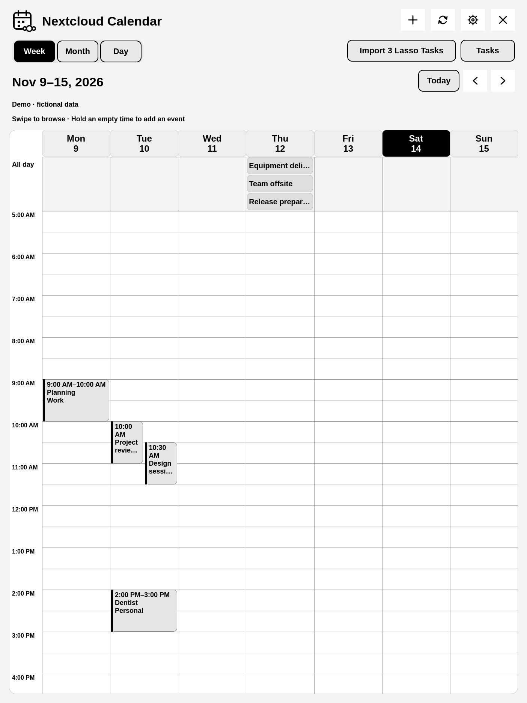
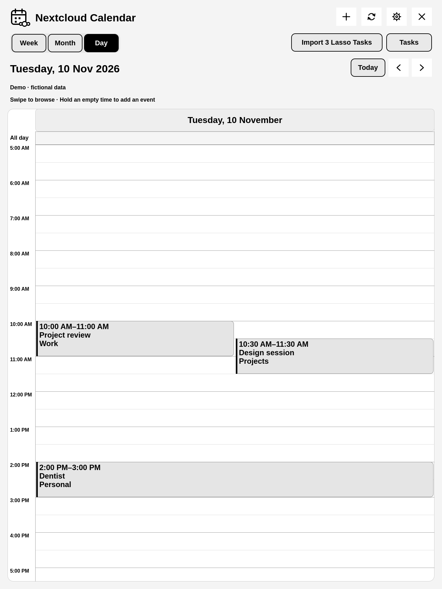
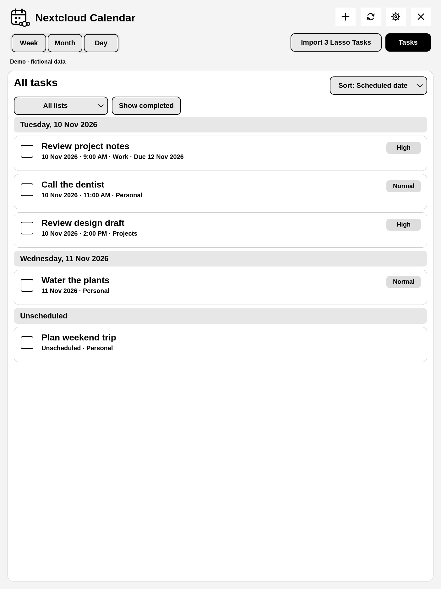
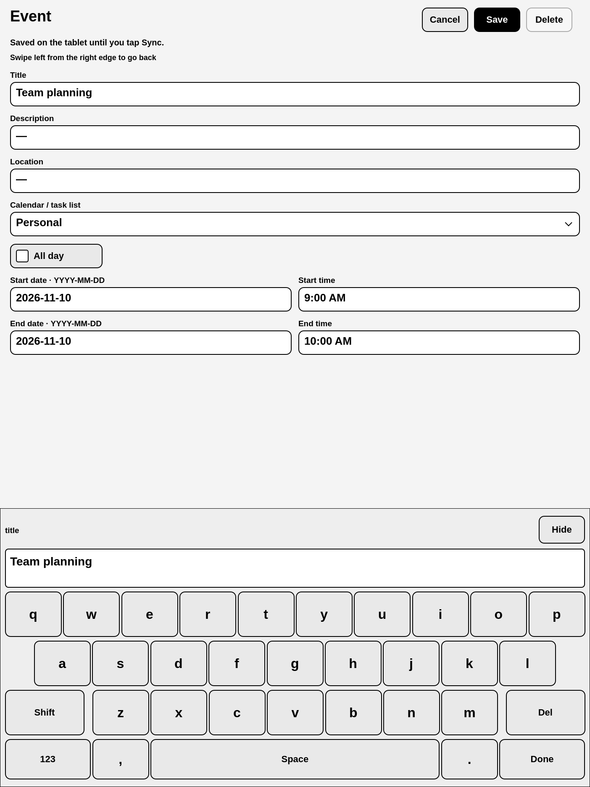
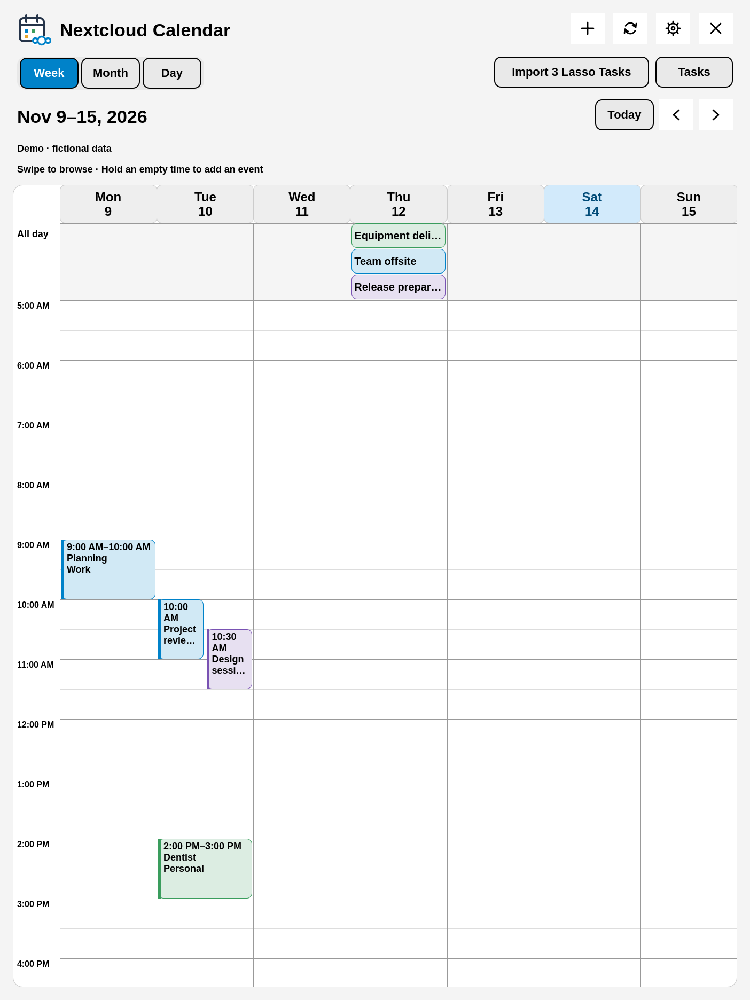
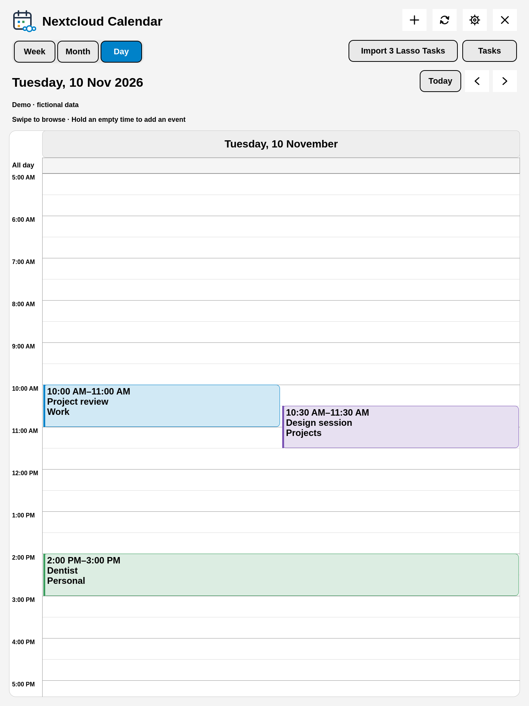
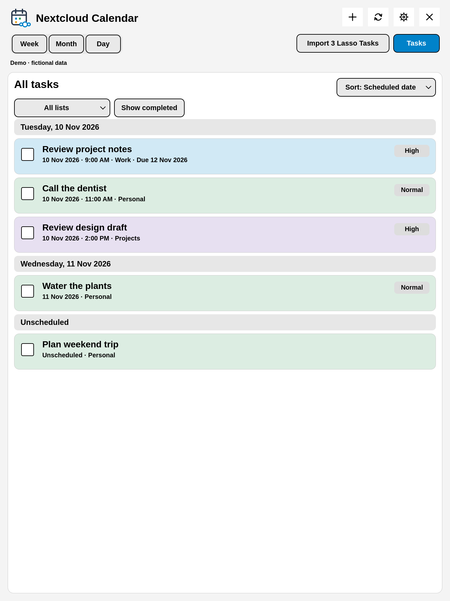
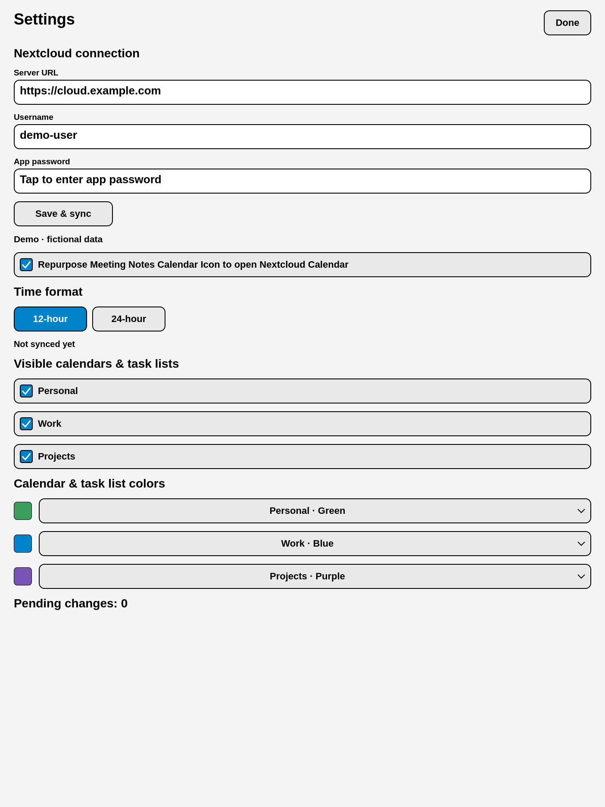
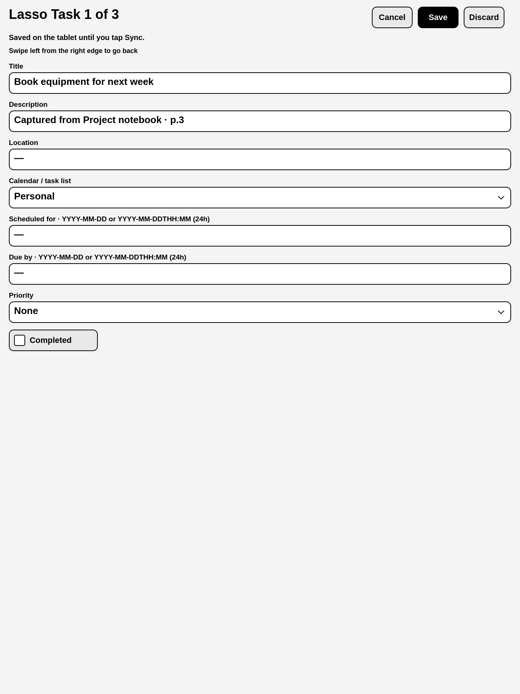

# reMarkable Nextcloud Calendar

A native calendar and task app synced directly with your Nextcloud server over
HTTPS/CalDAV. It uses XOVI and AppLoad, with ARMv7 builds for reMarkable 1/2 and
an experimental aarch64 build for Paper Pro/Move. Color devices use color accents;
grayscale devices retain the monochrome interface.

| Week timeline | Day timeline |
| --- | --- |
|  |  |

| Tasks | Event editor and keyboard |
| --- | --- |
|  |  |

## Features

- Day and week timelines with proportional event blocks, overlap columns, and
  a 05:00–22:00 time range. The all-day section expands to fit its events.
- Month grid, week date-range headings, and a separate Tasks button.
- Create, edit and delete ordinary events and tasks; complete and reopen tasks.
- Select a destination calendar/list from a dropdown. Event time dropdowns use
  15-minute intervals and the selected 12/24-hour display format.
- Combine task lists and sort by scheduled/start date, due date, priority, or title.
  Tasks without a scheduled/start date are shown as **Unscheduled**, not assigned
  their due date as a substitute. Priority sorting puts highest priority first.
- Discover shared calendars, task capabilities, and write privileges.
- Optional lasso-to-task handwriting capture on firmware 3.27.x; import and review
  captured tasks using the counted Import button to the left of Tasks. Save or
  Discard advances through the queue, with progress such as **Lasso Task 1 of 3**. See [setup](INSTALL.md#optional-lasso-to-task-capture-firmware-327x).
- Local offline cache and persistent pending edits; manual **Sync** over Wi-Fi.
- Conditional CalDAV writes and visible conflict/error handling.
- In-app server URL, username, and masked app-password entry. Each installation
  uses its own credentials and cache; no server or account is preconfigured.
- Per-calendar/task-list colors in Settings on color devices. Soft colored event
  blocks, all-day events, task cards, and blue selected controls; settings persist
  locally without changing Nextcloud's own calendar colors. Unknown devices default
  to grayscale. The color logo uses a charcoal calendar and blue Nextcloud symbol.
- Optional home-screen meeting-notes icon shortcut. In Settings, toggle
  **Repurpose Meeting Notes Calendar Icon to open Nextcloud Calendar** to switch
  between this app and the stock action without restarting the UI after setup.
- Rounded controls, a calendar/Nextcloud launcher icon, and a custom
  US mobile QWERTY keyboard with equal-sized letter keys.

Recurring events are viewable, including ordinary detached exceptions, but
recurring items and meeting invitations are read-only. There is no guest
management, automatic background sync, or event drag-to-reschedule.
See [limitations](docs/DEVELOPMENT.md#limitations).

## Color-device screenshots

These are real QML renders using fictional data, not photographs of color hardware.
The four design explorations and chosen logo are retained in
[design options](docs/design-options/README.md); style **C: Color accents** was selected.

| Color week | Color day |
| --- | --- |
|  |  |

| Task list colors | Calendar colors in Settings | Lasso import progress |
| --- | --- | --- |
|  |  |  |

## Requirements

- **reMarkable 1 or 2:** ARMv7 bundle. RM2 tested on-device; RM1 confirmed working
  by the user. **Paper Pro/Move:** separate aarch64 bundle, built and tested off-device
  only; physical device compatibility and color rendering remain unverified.
- XOVI and its Qt resource rebuilder installed and working.
- AppLoad compatible with your firmware. The tested combination is firmware
  **3.27.3.0**, Qt **6.8.2**, and **AppLoad 0.5.3 ARM32**.
- SSH access to the tablet for installation, and Wi-Fi for Nextcloud sync.
- An HTTPS Nextcloud installation with Calendar/Tasks enabled, a user account,
  and an app password with access to the calendars/lists you want to use.

Install XOVI and AppLoad using their own instructions before installing this app:
[XOVI](https://github.com/asivery/xovi),
[AppLoad](https://github.com/asivery/rm-appload),
[AppLoad 0.5.3](https://github.com/asivery/rm-appload/releases/tag/v0.5.3).
Match their builds to your firmware and architecture; this package does not
install or replace XOVI, AppLoad, firmware, or system libraries.

## Install

Download the ARMv7 or aarch64 archive matching your tablet and `SHA256SUMS` from [GitHub Releases](https://github.com/Ampleforth/remarkable2-nextcloudCalendar/releases/latest).
Follow [the installation guide](INSTALL.md) for tablet setup, direct install,
Nextcloud sign-in, source builds, or a local Vellum install. A ready-to-install bundle, installer, licenses
and these instructions are included in the archive. No compiler is needed to use it.

To build it yourself, see [Build from source](#build-from-source).

## Connect your Nextcloud account

1. Open **AppLoad → Nextcloud Calendar → Settings**.
2. Replace the example Server URL with your own HTTPS Nextcloud base URL, such as
   `https://cloud.example.com`. Do not enter a CalDAV resource URL.
3. Enter your username and an app password generated in Nextcloud's Security settings.
4. Tap **Save & sync**, then choose your visible calendars and task lists.

The app never loads a saved password back into the UI. A blank password retains
it only when the server and username are unchanged. Switching accounts requires
resolving pending edits first and clears the old account's downloaded cache.
Passwords are stored in a local JSON file with permissions `600`, not encrypted.

Times default to **UTC**. To set another IANA timezone, such as `Europe/London`,
use the optional configuration-file instructions in [INSTALL.md](INSTALL.md#timezone-and-manual-configuration),
then close and reopen the app. The 12/24-hour display toggle is available in Settings.

## Touch controls

- Swipe left/right to change the day, week, or month.
- Swipe vertically to scroll the hourly schedule.
- Tap Hide or Done to dismiss the keyboard. Partial date input
  is retained while editing; invalid dates must be corrected before saving.
- Tap an event, day heading, or month date to open it.
- Press and hold an empty time slot to create an event there; tap Save to keep it.
- Swipe left starting at the right edge of an editor or Settings to go back.
  In the editor this cancels unsaved changes, just like Cancel.

All-day end dates are exclusive. Task **Scheduled for** maps to CalDAV `DTSTART`;
**Due by** maps to `DUE`. The task editor accepts dates or ISO local date-times.

## Build from source

Requirements: Go **1.25+**, Qt 6 `rcc`, `rsvg-convert` (librsvg), and Python 3 for
optional setup/lifecycle helpers. `qmltestrunner` is used by the UI tests.

```sh
./scripts/build.sh
./scripts/package.sh 0.2.0 arm
CALENDAR_GOARCH=arm64 ./scripts/build.sh
./scripts/package.sh 0.2.0 arm64
```

If necessary, specify executable locations:

```sh
GO=/path/to/go RCC=/path/to/rcc ./scripts/build.sh
```

`dist/nextcloud-calendar/` is the ARMv7 AppLoad bundle;
`dist/nextcloud-calendar-arm64/` is the separate aarch64 bundle. `release/` contains a portable
installation archive and checksums. Builds use `CGO_ENABLED=0`, Linux ARMv7, and
`-trimpath`; no desktop build paths or runtime configuration files are included.

## Development, privacy, and license

[Development and tests](docs/DEVELOPMENT.md) · [Security and local data](SECURITY.md)

The screenshots are rendered from fictional demo data, not a connected account.
No real credentials, cache files, or deployment configuration are distributed.
The in-process HTTP API listens only on loopback at port `38766`.

Licensed under **GNU GPL version 3 only (`GPL-3.0-only`)**. See [LICENSE](LICENSE).
The UI was inspired by [Nicko Guyer's reMarkable Calendar](https://github.com/nguyer/remarkable-calendar);
`qml/ToolbarButton.qml` includes adapted MIT-licensed code, with its notice kept in
[LICENSE.upstream.md](LICENSE.upstream.md). Dependency licenses are retained in
[THIRD_PARTY_NOTICES.md](THIRD_PARTY_NOTICES.md) and `licenses/`.

This is an independent community app. reMarkable and Nextcloud names and marks
belong to their respective owners.

## Thanks to reTaskable

The handwriting lasso capture hook is adapted from **[jdkruzr](https://github.com/jdkruzr)'s
[reTaskable](https://github.com/jdkruzr/reTaskable)**, under GPL-3.0-only. Their
non-destructive handwriting capture, recognition dialog, and source-note metadata
made this integration possible. Our Go backend adds the review queue, progress,
durable duplicate prevention, and Discard flow. See the exact upstream commit and
license attribution in [THIRD_PARTY_NOTICES.md](THIRD_PARTY_NOTICES.md).
